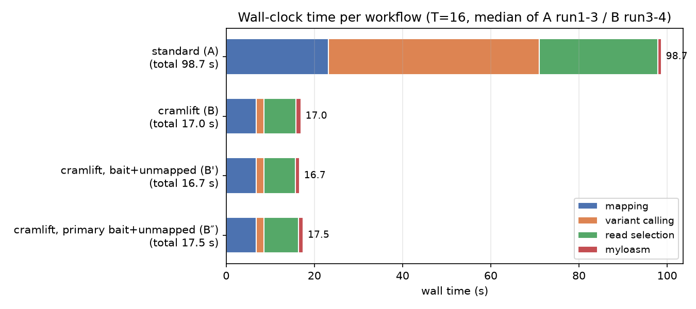
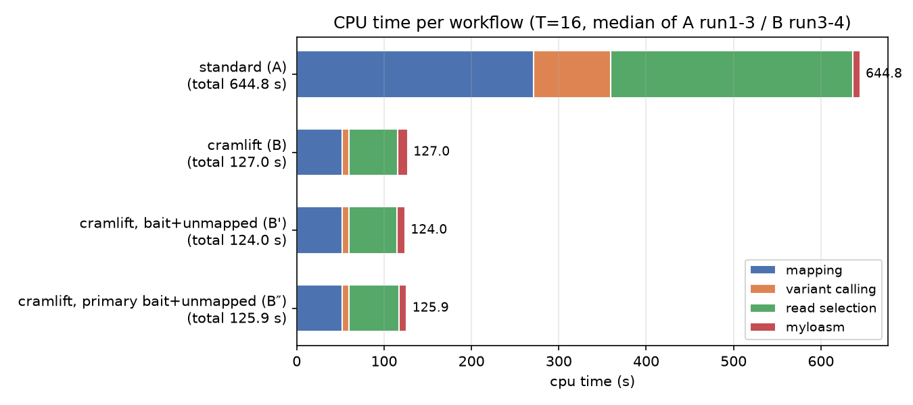
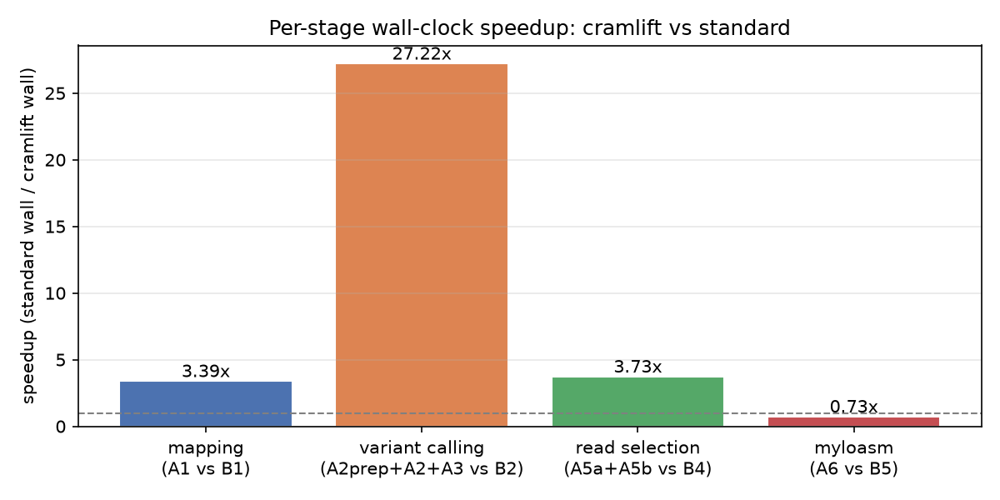

# Case study: recovering a missed phage with `cramhook` (ONT FAM20853)

How does a 4-command `cramhook` workflow (lift / qc / fish / myloasm) compare with a
standard minimap2 + Clair3 + Sniffles2 + myloasm script when an assembly is updated and a
phage that used to be recoverable is no longer a separate contig?  This note uses one real
Oxford Nanopore dataset and reports wall time, CPU time, peak memory, what each tool called,
and what the reassembly produced.  It is written for a bioinformatician who has not seen
`cramhook` before; the tools are explained as they come up.

All numbers here come from `scratch/wfcmp/run.sh` (see **Reproduce** at the end; the scripts and
data are local, not part of the repository).

## Scenario

A bacterial isolate (ONT FAM20853, ~3 Mb genome) was assembled (`cons`) and then polished
(`polished`).  The isolate carries a temperate phage: in the new assembly the phage is *not*
its own contig - it exists only as a **prophage** integrated at `1:201,976-242,860` (40,884 bp,
`-` strand) - and it is also present in the reads as **free circular copies** of the phage
genome.  The old assembly has a mapping already (`old.cram`, mapped to `old.fa`); the new
reads (`reads.fastq.gz`, 794 MB) are the same library.  The goal is to (a) *notice* that a
phage is sitting there and (b) *recover* its sequence, using a bait equal to the curated phage
contig (`phage.fa`, 40,884 bp md5 `eeac1de4...`, the same file both workflows get).

## The two workflows

Both use the same bait file and 16 threads; both end with `myloasm` on the selected reads.

**A - standard** (a typical script; `new.fa` = polished, preset `lr:hq`, matching
`old.cram`):

```bash
# 1. remap all reads to the new assembly
minimap2 -ax lr:hq -t 16 --secondary=no -Y new.fa reads.fastq.gz \
  | samtools sort -@ 16 -O CRAM --reference new.fa -o std.cram -
samtools index std.cram
# 2. variant calling - Clair3 needs a BAM: convert and index first (A2prep), then run Clair3
samtools view -b -T new.fa -@ 16 -o std.bam std.cram
samtools index -@ 16 std.bam
#    Clair3 (ONT r1041 sup v520) + 3. Sniffles2 (defaults)
pixi run -e testing-clair3 run_clair3.sh --bam_fn std.bam --ref_fn new.fa \
  --threads 16 --platform ont --model_path .../r1041_e82_400bps_sup_v520 \
  --output clair3 --include_all_ctgs --haploid_sensitive --sample_name sample
pixi run -e testing-sniffles2 sniffles --input std.cram --reference new.fa \
  --vcf sniffles.vcf --threads 16
# 4. detection gate: an SV call inside prophage +/- 1 kb
# 5. second full mapping, then extract phage-contig reads + the unmapped reads
cat new.fa phage.fa > combined.fa
minimap2 -ax lr:hq -t 16 --secondary=no -Y combined.fa reads.fastq.gz \
  | samtools sort -@ 16 -O CRAM --reference combined.fa -o bait.cram -
samtools index -@ 16 bait.cram
samtools view -u bait.cram FAM20853-p1-1.1_scf3 | samtools fastq - | gzip > phage_reads.fastq.gz
samtools fastq -f 4 -n std.cram | gzip > unmapped.fastq.gz
cat phage_reads.fastq.gz unmapped.fastq.gz > combined_reads.fastq.gz
# 6. reassemble the selected reads
pixi run -e testing-myloasm myloasm combined_reads.fastq.gz -o reasm -t 16
```

**B - cramhook** (`lift` translates the old CRAM onto the new reference; `qc` scans the
lifted CRAM for junction/coverage/variant signals; `fish --bait` selects the reads worth
reassembling and includes its own chained lift):

```bash
cramhook lift --in old.cram --old-ref old.fa --new-ref new.fa \
  --out lift.cram --threads 16 --stats lift.stats.json
cramhook qc   --in lift.cram --ref new.fa --out-prefix qc --threads 16 --preset lr:hq
# detection gate: a qc finding of tier >= yellow inside prophage +/- 1 kb
cramhook fish --in lift.cram --ref new.fa --out-prefix fish --threads 16 \
  --findings qc.findings.bed --haplotypes qc.haplotypes.tsv --bait phage.fa
pixi run -e testing-myloasm myloasm fish.fastq.gz -o reasm -t 16
```

A variant **B'** is also scored: `fish` as above but keeping only the `bait` and `unmapped`
categories (`--no-clips --no-indels --no-linked`), i.e. dropping the clip / large-indel /
haplotype-linked reads that carry flanking chromosome sequence (see *Outcome*).  A variant **B″**
adds `--bait-records primary` to B′: a read is kept for `bait` only when its **primary** record is
on the bait, so the 9 chimeric reads whose only bait record is a supplementary alignment are
dropped and, with the bait + unmapped set, the selection becomes the standard workflow's read set.

## Speed

Machine: **AMD Ryzen 7 7800X3D** (8 cores / 16 threads SMT), **31.7 GB RAM**, otherwise idle;
**T = 16** threads for every tool.  Figures show the median; A is the median of 3 runs
(run1-3), B of 2 runs (run3-4).  Per-step numbers are medians of the *step*, so stage medians
may differ by <0.1 s from the median of totals.







| stage (A / B) | A wall s | A CPU s | A peak RSS GB | B wall s | B CPU s | B peak RSS GB | speedup |
|---|---|---|---|---|---|---|---|
| mapping (A1 / `lift` B1) | 23.2 | 270.9 | 3.42 | 6.8 | 52.0 | 2.44 | **3.39x** |
| variant calling (A2prep+A2+A3 / `qc` B2) | 47.8 | 88.4 | 1.59 | 1.8 | 7.8 | 0.81 | **27.22x** |
| read selection (A5a+A5b / `fish --bait` B4) | 26.9 | 277.2 | 3.47 | 7.2 | 55.4 | 2.40 | **3.73x** |
| myloasm (A6 / B5) | 0.9 | 8.3 | 1.90 | 1.2 | 11.9 | 1.96 | 0.73x |
| **total end to end** | **98.7** | **644.6** | **3.47** | **17.0** | **127.0** | **2.44** | **5.81x** |

Headline: **98.7 s versus 17.0 s wall (5.8x)**, **644.6 s versus 127.0 s CPU (5.1x)**, peak
RSS 3.47 GB versus 2.44 GB.  All runs of all workflows are in the appendix.

### Why cramhook is faster

`lift` does not realign reads; it **translates** their old coordinates onto the new reference
through the coordinate diff between `old.fa` and `new.fa`.  On this dataset it reported
`contract_ok=true` and **translated 108,193 of 118,936 reads (91.0%)**, remapping the
remaining **10,743 (9.0%)** (the deferred ones are reads lift cannot safely place: clip,
divergence, MAPQ, split, and 4,599 reads hit by the new T2-junction taint).  Lifting all the
reads - translating 108,193 and remapping the other 10,743 - takes **6.8 s**, where a
from-scratch full remap (A1) takes **23.2 s**.

`qc` is a **single scan plus a linkage pass** (1.8 s wall) over the already-lifted CRAM.  The
standard path runs three tools and an extra CRAM->BAM conversion for Clair3 - 47.8 s of wall
time (and two independent callers to reconcile).

`fish --bait` needs the reads sitting on the bait, but it does not remap all 794 MB again: it
**chains a lift on the already-lifted CRAM** (reported separately: `contract_ok=true`,
**111,565 of 118,936 reads translated (93.8%)**, 7,371 remapped) and only maps what it must.
That is why read selection is 7.2 s instead of the standard workflow's **second** full remap
(A5a+A5b, 26.9 s).

The standard workflow's mapping cost is paid **twice** (A1 once, A5a once); cramhook's is paid
as one full re-computation (B1 `lift`, 6.8 s) plus one chained lift inside `fish` (7.2 s), and
both translate most reads instead of aligning them.

The one place A is faster is the final `myloasm`: A hands it 794 reads, B 912, so B's
reassembly takes 1.2 s versus 0.9 s - a 0.3 s difference, irrelevant next to the 82 s saved
earlier.

## Outcome

### Detection

An assembly update is supposed to be transparent; the interesting question is whether a tool
notices the phage is there.

* **Standard (Sniffles2).** Exactly one SV call overlaps the prophage +/- 1 kb, but it is a
  **whole-contig DUP** (`1:1-2,933,710`, `SVTYPE=DUP`, `SVLEN=2,933,709`, `SUPPORT=322`,
  `QUAL=59`) - the entire chromosome labelled as duplicated, i.e. a mapper artefact, not a
  localized signal.  There is **no call at the prophage itself**.  The gate is met only
  technically.
* **cramhook (`qc`).** finding_1 at `1:201,776-243,061` (orange, `likely=misjoin`,
  `members=split_junction:2`) exactly spans the prophage.  Underlying it are two region calls
  (`qc.bed`): `split_junction` at `1:201,776-202,177` and `1:242,660-243,061`, each
  `reads=15`, `span=40,884`, `orient=tandem`, pointing at each other.  These are the two
  prophage boundaries, which is precisely the signal that a 40.9 kb segment is integrated.

So `qc` gives a **prophage-localized** finding; Sniffles2 gives a chromosome-wide artefact that
happens to cover it.

### Reads sent and phage recall

Truth = **732** reads with a record on the phage contig `FAM20853-p1-1.1_scf3` in the oracle
CRAM `ont_FAM20853__polished-to-pbfinal/oracle.cram`.

| workflow | reads sent | of which truth | non-phage reads | recall |
|---|---|---|---|---|
| A (746 phage-contig + 48 unmapped) | 794 | 505 | 289 | 69.0% |
| B (755 bait + 104 clip + 14 ins + 6 del + 35 linked + 48 unmapped) | 912 | 528 | 384 | 72.1% |
| B' (755 bait + 48 unmapped) | 803 | 513 | 290 | 70.1% |
| B″ (746 primary-bait + 48 unmapped) | 794 | 505 | 289 | 69.0% |

B finds more of the true phage reads (72.1% vs 69.0%) but also sends far more non-phage reads
(384 vs 289) because the clip / indel / linked categories pull in flanking chromosome sequence.
B″ sends the same 794 reads as A (the same set), so its 505 / 289 / 69.0% are identical.

### Reassembly (myloasm contigs mapped back to the bait)

| workflow | contigs | best contig | length | coverage | identity | >=95% covered | circular |
|---|---|---|---|---|---|---|---|
| A | 1 | `u728ctg_len-40865_circular-yes…` | 40,865 | 100.0% | 100.00% | yes | **yes** |
| B | 3 | `u302ctg_len-70622_circular-no…` | 70,622 | 100.0% | 100.00% | yes | no |
| B' | 1 | `u481ctg_len-62664_circular-no…duplicated-possibly` | 62,664 | 100.0% | 100.00% | yes | no |
| B″ | 1 | `u728ctg_len-40865_circular-yes…` | 40,865 | 100.0% | 100.00% | yes | **yes** |

**Where the standard workflow's reassembly did better:** A's myloasm result is the clean one — a
single 40,865 bp contig flagged circular, essentially the free phage replicon.  B and B' contain
the whole phage (100% coverage and identity to the bait) but as longer, **non-circular** contigs
(62.7 / 70.6 kb against the 40.9 kb bait) that the assembler does not close into a circle.
B″ recovers A's clean result exactly.

**B' versus B, and B″ versus A.**  Dropping the clip / large-indel / linked reads (109 reads,
912 -> 803) collapsed 3 contigs into 1 and shortened the best contig 70,622 -> 62,664 bp, but it
did **not** produce the hoped-for clean circular contig, and recall fell 72.1% -> 70.1%.  The
extra length does not need the clip/linked reads: A's 794 reads are a subset of B's 912, and B'
adds only **9** reads to A's set.  All 9 are chimeric molecules whose only bait support is a
**supplementary** alignment (their primary record is elsewhere); A's
`samtools view ... | samtools fastq` drops non-primary records, so A never hands them to myloasm,
while `fish --bait` keeps the read, and these junction-spanning molecules are enough to move the
assembly off the clean circle.  `--bait-records primary` drops exactly those supplementary-only
reads: with the bait + unmapped set (B″) the selected set is **set-identical to A's 794 reads** and
myloasm returns A's clean **circular 40,865 bp** contig again.

Net: all four variants **find and recover the phage sequence**.  B and B' do it from an incomplete
circle; B″ reproduces the standard read set and its clean circular reassembly exactly.

## What each tool found on the polished assembly

qc from `run3/B`, Clair3 / Sniffles2 from `run3/A` (full detail in
`scratch/wfcmp/FAM20853/tools_summary.md`).

| tool | output | count |
|---|---|---|
| cramhook `qc` | findings (`qc.findings.bed`) | 11: 4 orange, 7 yellow, 0 red |
| cramhook `qc` | region calls (`qc.bed`) | 3: 2 `split_junction` (the prophage flanks), 1 `linked_haplotype` |
| cramhook `qc` | variants (`qc.vcf`) | 30 PASS: 2 ORANGE, 9 YELLOW, 19 GRAY; 9 SNP + 2 DEL outside GRAY; haploid |
| Clair3 | `merge_output.vcf.gz` | 30 PASS: 26 SNP, 4 INDEL; haploid |
| Sniffles2 | `sniffles.vcf` | 1 PASS: 1 DUP (whole-contig artefact) |
| overlap | Clair3 PASS inside a qc finding +/-10 bp | 8 / 30 |
| overlap | Clair3 PASS within a qc.vcf call +/-10 bp | 11 / 30 |
| overlap | Sniffles2 calls inside a qc finding +/-1 kb | 1 (the whole-contig DUP) |

## How to look at it

Open the run3 tracks in IGV (the view is on the polished assembly; look at contig `1` around
**201,976-242,860**, the prophage):

```bash
python igv-viewer.py --files scratch/wfcmp/FAM20853/igv_files.tsv
```

The file has unique case names: `FAM20853-standard` (std.cram + Clair3 + Sniffles2),
`FAM20853-cramhook` (lift.cram + qc tracks), and the bait mappings for both plus B'.
At the prophage you should see the two `split_junction` regions at its ends (15 reads each whose
alignments join the prophage end back to its start: the excised circular copies) and a slightly
higher depth inside the prophage (mean 334x vs 309x in the 50 kb flanks; the free copies are only
~5 % of reads, too few for a depth call). The Sniffles2 whole-contig DUP is only visible as a
chromosome-wide band.

## Caveats

* **One dataset, one machine.**  These are point measurements on a single ONT library and a
  single workstation; ratios will move on other data and hardware.
* **The mapping assumption.**  `lift` needs the reads **already mapped to the old assembly**
  (`old.cram`).  The standard workflow's mapping (A1) builds that mapping from scratch; if the
  old CRAM did not exist, cramhook would have to pay for it too.  Adding that once
  (an A1-equivalent ~23 s; the original `old.cram` mapping was not re-timed here) gives a still
  favourable end-to-end of roughly **40 s versus 98.7 s (~2.5x)** rather than 5.8x.
* **Sniffles2 was run with its defaults** (as in the user's script; no `--mosaic` etc.), and
  Clair3 with the ONT r1041 sup v520 model in haploid-sensitive mode.  Other settings could
  change the detection story.
* **The bait is pre-extracted and identical for both workflows.**  The file the spec nominated
  under `data/v2` (the curated assembly) was regenerated upstream and no longer contains the
  phage contig, so the pre-extracted bait matching the oracle `M5` was used
  (see `scratch/wfcmp/FAM20853/DERIVATION.md`).
* **Timing mix.**  A is the median of 3 runs (run1 2026-10-16, run2/run3 2026-10-17); B of 2
  runs (both 2026-10-17, binary at master `3454eda`).  B run1 used the earlier binary, whose
  `fish --bait` did not yet accept lifted input (it fell back to a full remap) and is kept only
  in the appendix.  A2prep (CRAM->BAM) is counted in A's calling stage; `cramhook` reads CRAM
  directly, so it has no equivalent step.
* **Coverage/identity** come from `minimap2 -cx asm20` of the myloasm contigs against the bait;
  `circular` is myloasm's own flag.
* **myloasm is one assembler**; "recovered" here means "a contig covering the bait at ~100%
  identity", which all four variants achieve.  Only A and B″ give the clean circular 40,865 bp
  contig; B and B' are longer and non-circular (see the reassembly table).

## Reproduce

`run.sh` lives in `scratch/` (see its header for the full usage); run it from the repository
root.  `both` writes `run<N>/A.timing.tsv` and `run<N>/B.timing.tsv`; each timed step is
`/usr/bin/time -f "%e\t%U\t%S\t%M"` (wall / user / sys / max RSS kB).

```bash
cd <repo>

# workflows, timed, serial (machine otherwise idle)
bash scratch/wfcmp/run.sh scratch/wfcmp/FAM20853 3 both 16   # A then B
bash scratch/wfcmp/run.sh scratch/wfcmp/FAM20853 4 B 16      # B again

# variant B': fish on run3's lift/qc, bait + unmapped only, then myloasm
export PATH="$PWD/.pixi/envs/default/bin:$PATH"
target/release/cramhook fish \
  --in scratch/wfcmp/FAM20853/run3/B/lift.cram --ref scratch/wfcmp/FAM20853/new.fa \
  --out-prefix scratch/wfcmp/FAM20853/run3/Bprime/fish --threads 16 \
  --findings scratch/wfcmp/FAM20853/run3/B/qc.findings.bed \
  --haplotypes scratch/wfcmp/FAM20853/run3/B/qc.haplotypes.tsv \
  --bait scratch/wfcmp/FAM20853/phage.fa --no-clips --no-indels --no-linked
pixi run -e testing-myloasm myloasm \
  scratch/wfcmp/FAM20853/run3/Bprime/fish.fastq.gz \
  -o scratch/wfcmp/FAM20853/run3/Bprime/reasm -t 16

# variant B″: B' plus --bait-records primary (drops supplementary-only bait reads), then myloasm
target/release/cramhook fish \
  --in scratch/wfcmp/FAM20853/run3/B/lift.cram --ref scratch/wfcmp/FAM20853/new.fa \
  --out-prefix scratch/wfcmp/FAM20853/run3/Bpp/fish --threads 16 \
  --findings scratch/wfcmp/FAM20853/run3/B/qc.findings.bed \
  --haplotypes scratch/wfcmp/FAM20853/run3/B/qc.haplotypes.tsv \
  --bait scratch/wfcmp/FAM20853/phage.fa --bait-records primary --no-clips --no-indels --no-linked
pixi run -e testing-myloasm myloasm \
  scratch/wfcmp/FAM20853/run3/Bpp/fish.fastq.gz \
  -o scratch/wfcmp/FAM20853/run3/Bpp/reasm -t 16

# scoring and figures
pixi run python scratch/wfcmp/score.py --case scratch/wfcmp/FAM20853 --run 3
pixi run python scratch/wfcmp/score.py --case scratch/wfcmp/FAM20853 --run 4
pixi run python scratch/wfcmp/score.py --case scratch/wfcmp/FAM20853 --run 3p   # B' (run3p/B -> run3/Bprime)
pixi run python scratch/wfcmp/score.py --case scratch/wfcmp/FAM20853 --run 3pp  # B″ (run3pp/B -> run3/Bpp)
pixi exec -s matplotlib -s python -- python scratch/wfcmp/case_study_figures.py
```

## Appendix: all runs

**Workflow A** (wall seconds per step; totals include every step):

| run | A1 | A2prep | A2 | A3 | A5a | A5b | A6 | total wall | total CPU | peak RSS GB |
|---|---|---|---|---|---|---|---|---|---|---|
| A run1 | 23.19 | 5.11 | 31.75 | 10.91 | 23.69 | 3.20 | 0.88 | 98.73 | 645.6 | 3.47 |
| A run2 | 23.11 | 5.04 | 30.47 | 10.98 | 23.53 | 3.17 | 0.88 | 97.18 | 644.6 | 3.48 |
| A run3 | 23.73 | 5.05 | 32.13 | 10.93 | 23.70 | 3.23 | 0.90 | 99.67 | 644.0 | 3.46 |

**Workflow B** (B4 = `fish --bait`; B' and B″ reuse run3's B1+B2):

| run | B1 | B2 | B4 | B5 | total wall | total CPU | peak RSS GB |
|---|---|---|---|---|---|---|---|
| B run1 (old binary) | 5.24 | 1.70 | 21.35 | 1.18 | 29.47 | 328.2 | 3.19 |
| B run3 | 6.83 | 1.76 | 7.16 | 1.20 | 16.95 | 126.7 | 2.48 |
| B run4 | 6.84 | 1.75 | 7.25 | 1.20 | 17.04 | 127.4 | 2.40 |
| B' run3 (B4p/B5p) | 8.59 (B1+B2) | - | 7.10 | 0.97 | 16.66 | 124.0 | 2.44 |
| B″ run3 (B4pp/B5pp) | 8.59 (B1+B2) | - | 7.85 | 1.06 | 17.50 | 125.9 | 2.44 |

Medians used above: A total wall 98.73 s (n=3), B 17.0 s (n=2).  B run1 (old binary, pre
lift-input) was 29.5 s because `fish --bait` remapped all reads instead of chaining a lift.
