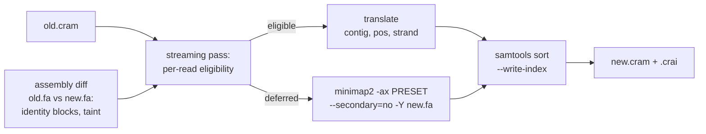

# lift: move alignments to a revised assembly

**Move long-read alignments from an old bacterial assembly to a new one without remapping every
read.**

Bacterial assemblies get revised: contigs are rotated or reoriented (e.g. to *dnaA*), polishing
edits accumulate, a plasmid appears or disappears. Normally every revision means remapping all
reads, although most of the genome is unchanged. `cramhook lift` takes the existing CRAM (reads
mapped to the old assembly), compares the old and new assembly, and:

- **translates** reads that lie inside long unchanged, unambiguous regions: only contig, position
  and strand change;
- **remaps** all other reads with the same minimap2 command;
- writes one coordinate-sorted, indexed CRAM for the new assembly.

Typical speedup over a full remap is **2–6×**: median 4.0× on the real use case (a cleaned
assembly → a revised or reoriented cleaned assembly), 2.7× on raw ONT assemblies → polished and 4.8×
on PacBio HiFi (see [Performance and validation](#performance-and-validation)).

Correctness comes first: if a read's mapping could plausibly differ in the new assembly, it is
remapped. In the worst case, cramhook is merely not faster than a full remap.

## Quick start

```bash
# the input must come from exactly this command shape (see "Input contract")
minimap2 -ax lr:hq -t 16 --secondary=no -Y old.fa reads.fastq.gz \
  | samtools sort -O CRAM --reference old.fa -o old.cram

cramhook lift --in old.cram --old-ref old.fa --new-ref new.fa --out new.cram \
              --threads 16 --stats stats.json
```

Requirements: Linux, plus `minimap2` and `samtools` on `PATH`. `CRAMHOOK_MINIMAP2` and
`CRAMHOOK_SAMTOOLS` override only the remap minimap2 and the output sort; the diff and indexing
still use `PATH`.

## How it works



1. **Assembly diff.** `minimap2 -cx asm5 --cs` aligns old to new. From the `cs` strings cramhook
   derives **identity blocks**: maximal exact-match runs, each with old interval, new contig,
   new start and strand. Every SNP or indel ends a block. A rotation gives two blocks; a
   reverse-complemented contig gives a `-` block.
   The diff fails safe: a missed alignment means fewer blocks and more remapping, never a wrong
   translation.
2. **Taint.** Three kinds of old sequence are marked unsafe:
   - **T1**: old sequence that is not aligned exactly once (deleted, or collapsed duplications).
   - **T2**: old sequence that resembles **novel** sequence in the new assembly. This is the
     important case. Example: a new plasmid carries a copy of an IS element that also sits on the
     chromosome. A read on the chromosomal copy is unchanged, but it now has a competing locus, so
     its old MAPQ would be stale. To find such regions, the novel sequence is cut into
     read-length windows and mapped back to `old.fa`. This uses the read preset and keeps all hits
     (`-N 1000000 -p 0.000001`). The old bases aligned to novel bases are tainted.
   - **T2 junction**: old sequence that resembles the sequence **across a new adjacency** that
     adds no base. A deletion can join a copy that an old contig held fragmented, so the new
     assembly gains a competitor while adding no novel position — T2 sees nothing. At every
     junction where adjacent new positions come from non-adjacent old positions (a deletion inside
     a block chain, a contig join, a strand flip, or a circular rotation), a
     `[j − --t2-junction-flank, j + --t2-junction-flank)` (50 bp) interval is probed and projected
     exactly like T2. These intervals are kept apart from `novel`, so the clip screen is unchanged.
     Junctions are found from block-end events (robust to nested blocks) and include the
     last-block→first-block seam of a new contig (all new contigs are treated as circular). A
     junction window's **self-hit** — the window aligning back to the identity block that maps
     position `p`, same old contig/position/strand — is ignored, because reads on the junction's own
     source are handled by T1 (deleted sequence) or the origin-crossing split handling (a wrap).
     A circular wrap is a junction like any other (minimap2 indexes old contigs linearly, so a copy
     split by the old origin can become contiguous); the count is `junction_rotation_wraps`.
3. **Streaming pass.** The input CRAM is read once. Eligible reads are translated, and their records
   are written as uncompressed BAM into `samtools sort`. Deferred reads are streamed as FASTQ into
   an already running minimap2, whose output also goes into the sort. minimap2 builds its index
   while the diff runs.
4. **Checks.**
   - An always-on invariant compares the old and new reference bases under every translated
     read; any mismatch aborts.
   - Each read must appear exactly once as primary in the output.
   - The output is staged as `OUT.tmp.cram` and only renamed when all checks pass.

### Eligibility rules

A read is translated only if every rule passes. The first failing rule is recorded as the deferral
reason in `--stats`.

| Rule | Translated only if | Defer reason |
|------|--------------------|--------------|
| 1–2 | primary, mapped, no `SA` (split reads: see below) | `unmapped`, `split_*` |
| 3 | MAPQ ≥ `--min-mapq` (60) | `mapq` |
| 3b | no near-equal competitor: `s2 < --max-s2-ratio × s1` (0.5) | `competitor` |
| 4 | divergence `de` ≤ 0.01 (`map-hifi`) / 0.03 (`lr:hq`), or `--max-de` | `de` |
| 5 | total soft clip ≤ `--max-clip` (200 bp) | `clip` |
| 6 | only the expected tags `NM ms AS nn tp cm s1 s2 de rl SA` | `tags` |
| 7 | the window (alignment + clips ± `--margin` 500 bp, clipped to the contig) lies inside one identity block and touches no taint; if the unclipped window crosses a contig end, the new assembly must preserve that junction | `no_block`, `junction`, `taint_t1`, `taint_t2`, `taint_junction` |
| 7b | on `-` blocks: no indel ≥ `--max-minus-indel` (50 bp) | `minus_indel` |
| 7d | on `-` blocks: the old alignment's z-drop score (minimap2's split test, preset scoring) ≤ `--max-zdrop` (400) | `zdrop` |
| 7c | **clip screen**: no soft clip ≥ 20 bp shares ≥ 2 canonical 17-mers with changed sequence of `new.fa` (catches chimeric tails on new sequence) | `clip_hit` |

Rule 7d targets a minimap2 orientation effect: on a noisy stretch, ksw2's z-drop can split an
alignment in one orientation but not in the other. The score of the old alignment path is walked
with the preset's scoring (mismatches from the decoded `MD`); if its largest drop exceeds
minimap2's own z-drop (400), the read is remapped. This affects ~0.001 % of bases.

Rule 3b and T2 complement each other. 3b only sees the competitors minimap2 found in the *old*
assembly; T2 finds competitors that exist only in the *new* one. T2 junction taint covers a
competitor the new assembly creates by *joining old sequence* (a deletion that makes a fragmented
copy contiguous) while adding no novel base; such reads defer as `taint_junction`.

**Split reads** are remapped as a whole, with one exception: reads that cross the origin of a
circular contig. In some ONT datasets these are half of all reads. They are translated as a unit
if:

- they have exactly two records on one contig, one reaching each contig end;
- their `SA` tags are consistent;
- both records pass rules 3–7d (rule 5 on the outer clip only);
- the new assembly preserves the junction.

The `SA` tags are rewritten.

**Translation.** Contig and position come from the block. On `-` blocks, SEQ is
reverse-complemented, QUAL reversed, the CIGAR reversed and left-aligned (minimap2's convention),
and flag `0x10` toggled. MAPQ and tags are copied unchanged, except `s2` (removed; see
[Tags on translated reads](#tags-on-translated-reads)).

## What "equivalent" means

The validation criterion is: a translated read has the same contig, start, end, strand, MAPQ,
read length and `AS` as in a fresh minimap2 run. `NM` and `de` are reported but not compared.
cramhook itself checks the reference bases under every translated read, not agreement with a fresh
run; agreement is measured against full remaps (see below).

On `+` blocks the alignment content is unchanged: only coordinates change, a decode-generated `MD`
is stripped, `s2` is removed, `SA` is rewritten for split units, and `XL` is added. On
reverse-complemented (`-`) blocks, a few reads differ from a fresh run: 0–4 per real dataset (12 in
48 M5 cases), mostly in the CIGAR (and `AS`), rarely a 1 bp start shift. minimap2 places
equal-scoring indels differently depending on reference orientation, and mapping the reads to the
reverse-complemented assembly reproduces these differences. Supplementary records with MAPQ < 20
are ignored when comparing supplementaries (minimap2 adds or drops such placement-free records
depending on orientation; raw counts are still reported). Separately, rule 3b's 0.5 limit is a
heuristic: one read in 18 full-size cases kept MAPQ 60 where a fresh run gave 59 (s2/s1 = 0.498).

Clair3 and Sniffles2 calls were identical on lifted vs. fully remapped output for two real cases
with many `-` block reads. On a synthetic truth set, Clair3 on lifted output kept all 18 oracle
calls and found one additional true variant.

## Tags on translated reads

Every output record carries `XL:A:T` (translated: coordinates moved, alignment kept) or `XL:A:R`
(remapped by minimap2 against `new.fa`); `--no-xl-tag` omits it. Remapped records are exactly
what minimap2 writes. On translated records, measured against a fresh remap on 9.2 M translated
reads in 90 real cases ([results.md](https://github.com/Abrinca/cramhook/blob/main/docs/project/results.md), M10b):

| tag | on translated reads |
|---|---|
| `NM`, `MD` | correct: CRAM recomputes both from `new.fa` on decode |
| `AS`, `ms`, `de`, `nn`, `tp`, `SA`, MAPQ | equal on ≥ 99.9999 % of identical alignments; on `-` blocks a few CIGARs differ (orientation effect, see above) |
| `cm`, `s1`, `rl` | copied from the old run; equal on ≥ 99.999 % (rare small differences, ≤ 1 %) |
| `s2` | **removed**: the best competing score on the *old* assembly; it drifts when repeat content changes (99.15 % equal) and cannot be recomputed without remapping |

## Input contract

The input CRAM must have been produced by this command shape:

```bash
minimap2 -ax $PRESET -t N --secondary=no -Y old.fa reads.fastq.gz \
  | samtools sort -@ M -O CRAM --reference old.fa -o old.cram
```

- `$PRESET` is `map-hifi` (PacBio HiFi) or `lr:hq` (accurate ONT). It is read from the minimap2
  `@PG` line, which may contain only the preset, `-t`, `--secondary=no` and `-Y`.
- The header must contain exactly one minimap2 `@PG` (first), and every other `@PG` must be
  `samtools sort`. A CRAM produced by `cramhook lift` (a chain) is also accepted: each of its
  `cramhook` `lift` `@PG`s must carry a `DS` `remap=` command that uses the same preset, and each
  is followed by its own `samtools sort`. A CRAM that was further processed (e.g. `samtools view`)
  violates the contract.
- The input must be coordinate-sorted, single-end and include unmapped reads. Its `@SQ` names,
  lengths and order must match `old.fa.fai`; a mismatch is a hard error.
- **Contract violation:** cramhook remaps all reads and records the reason in the stats. With
  `--strict` it exits with an error instead. If the `@PG` line is unusable, `--preset` supplies the
  preset for this fallback.
- References are plain FASTA (`.fai` created if missing). CRAM I/O always uses the given reference,
  never a network lookup.

**Not supported (v1):** other aligners or minimap2 options (e.g. `--MD`, `--cs`), secondary
alignments, paired-end reads. A decode-generated `MD` is stripped; reads with other unexpected
tags (e.g. `cs`, `MM`) are remapped.

### Lifted input (chains)

A CRAM produced by `cramhook lift` (its `XL` tag and its `cramhook` `@PG` chain) may be lifted
again. A chain is only accepted when **every** lift in it (and the current lift) uses default
eligibility/safety options — paths, `--threads`, `--stats`, tagging, `--keep-tmp`,
`--min-input-mb`, `--preset`, `--strict` and `--progress` are allowed; anything that changes which reads are
translated (`--min-mapq`, `--max-clip`, `--margin`, `--max-de`, `--t2-*`, `--max-s2-ratio`,
`--max-minus-indel`, `--max-zdrop`, the `--clip-*` options, `--unsafe-no-clip-screen`) makes the
contract fail and the input is fully remapped. `de`, MAPQ, clips, `s1` and `SA` are re-tested
against each new revision; only `s2` is stripped when a record is translated (M10b), and it is then
trusted because it was checked at the same default `--max-s2-ratio`. The `@PG` `CL` is recorded
shell-quoted, so a path cannot smuggle an option, and every `cramhook lift` `@PG` carries an
`argv=sh1` marker in its `DS`; a lift `@PG` without it is from an older build and is **not**
chained (the input is fully remapped — rerun the earlier lift with this build).

Validated by `tests/lift_roundtrip.rs` (A→B→A and A→B→A→B over S1–S21 × hifi/ont; the random
`SR1`–`SR5` behind `--ignored`): every step is 100 % identical+equivalent with 0 mismatch against a
full remap of the reads onto that step's target by the `compare.py` equivalence criteria, primary
and supplementary, and A→B→A reproduces the original mapping. On the real data sets (70 cases,
tuning, hold-out and `data/v2`) A→B→A→B equals A→B read for read, and A→B→A matches the original
mapping in contig, strand and MAPQ for all 7.6 M reads (CIGAR-only differences from left-aligned
`-` translations; see [decisions.md](https://github.com/Abrinca/cramhook/blob/main/docs/project/decisions.md), "Round trips on the real data sets").

## CLI

```bash
cramhook lift --in old.cram --old-ref old.fa --new-ref new.fa --out new.cram \
  [--threads N] [--stats stats.json] [--no-xl-tag] [--strict] [--keep-tmp] [--preset map-hifi|lr:hq] \
  [--progress]
```

| Flag | Default | Purpose |
|------|---------|---------|
| `--threads` | all cores | minimap2 gets N, CRAM decode, sort and diff get N/2 each |
| `--min-input-mb` | 20 (`lr:hq`), 3 (`map-hifi`) | below this input CRAM size, skip the diff and remap all reads (`tiny_input` in the stats); 0 = never |
| `--stats` | – | JSON: counts, deferrals by reason, parameters, per-phase timings |
| `--no-xl-tag` | off | omit the `XL:A:T` (translated) / `XL:A:R` (remapped) tag (`--xl-tag` is accepted and is the default) |
| `--strict` | off | error on contract violation instead of remapping everything |
| `--keep-tmp` | off | keep the diff and the deferred reads in `OUT.tmp/` |
| `--progress` | off | machine-readable progress on stderr, one JSON object per line (phases `diff`, `translate_pass`, `writer_drain`, `sort_index`); see [output-format.md](../reference/output-formats.md#progress-stream-progress) |
| `--min-mapq`, `--max-s2-ratio`, `--max-de`, `--max-clip` (0 = unlimited), `--margin`, `--max-minus-indel`, `--max-zdrop` | see rules | eligibility thresholds |
| `--clip-k`, `--clip-min-hits`, `--clip-min-len`, `--clip-flank`, `--unsafe-no-clip-screen` | 17, 2, 20, 0, off | clip screen |
| `--t2-win`, `--t2-step`, `--t2-flank`, `--t2-junction-flank` | 10000, 2000, 10000, 50 | T2 windowing and junction taint (junction flank 0 disables it) |

### Output

- A coordinate-sorted CRAM with index, written at compression level 1. Files are ~1 % larger than
  at the default level, but encoding is faster.
- The header has an `@SQ` line for every contig of `new.fa`. It keeps the original `@PG` lines and
  adds a `cramhook` `@PG` line with the command line and the remap command, plus an `argv=sh1`
  marker in its `DS` (a unique id per lift: `cramhook`, `cramhook.1`, …).
- With `--stats`, a JSON file; its keys are listed in [output-format.md](../reference/output-formats.md#lift-stats-json).

### Debug subcommands

- `cramhook diff --old-ref --new-ref --preset --out-prefix P` writes the blocks, taint
  (`T1`/`T2`/`T2J`) and novel regions as BED, plus `junctions.bed`, the PAFs and a summary.
- `cramhook translate …` runs the classification only. It writes the translated BAM, the deferred
  FASTQ/TSV and the stats.
- `cramhook fish …` extracts the reads that disagree with the assembly (see [fish.md](fish.md)).

## Performance and validation

Each case is compared against a full remap with the same minimap2 command, using `--threads 16`.
The full remap writes CRAM at samtools' default compression level. Details are in
[results.md](https://github.com/Abrinca/cramhook/blob/main/docs/project/results.md).

| set | build | cases | speedup median (range) |
|-----|-------|-------|------------------------|
| use case: ONT cons → polished, polished → rotated/reoriented, polished → PacBio assembly; PacBio cons → finalized (full size) | current | 24 | 4.0× (2.1–6.0×) |
| ONT, full size (0.7–2.1 Gb reads), raw assembly → polished | M6/M7 | 18 | 2.7× (1.7–5.1×) |
| PacBio HiFi, consensus → finalized and raw → consensus | M6/M7 | 24 | 4.8× (1.2–6.5×) |
| ONT, same case types, 0.04–2.1 Gb reads | M5 | 24 | 1.8× (0.5–5.2×) |

Small datasets gain little: the diff and the final sort/encode take about 1–4 s, whatever the
number of remapped reads. Below `--min-input-mb` (an estimated full remap of ~2 s) cramhook
therefore just remaps everything. Speedup drops when many reads must be remapped: split reads across
structural differences, or repeat copies that differ between the assemblies.

In all 90 real cases, read depth (deletions counted) matched the full remap at ≥ 99.9999 % of
positions (max diff 1; 1–2 bp start shifts of single reads on `-` blocks, minimap2 orientation
effects). Supplementary records of translated reads agreed 100 % (MAPQ ≥ 20; see above). The
synthetic acceptance suite (`pixi run accept`) covers rotations, reverse complements, new plasmids,
IS copies, duplications, chimeric reads and the later edit classes (inversions, contig reorder,
split, join, translocation, a deletion-created competitor): S1–S21 with the
`S5c`/`S6b`/`S6c`/`S6w`/`S10a`/`S10b`/`S13b`/`S14b`/`S17b` variants plus the random `SR1`–`SR5`,
each on both read models. `tests/lift_roundtrip.rs` runs S1–S21 × hifi/ont A→B→A and A→B→A→B and
compares every step with its full-remap oracle (the random `SR1`–`SR5` round-trip is behind
`--ignored`).
