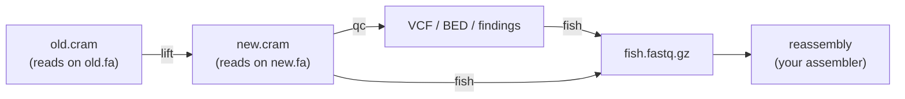

# cramhook

{ width="280" }
{ width="280" }

**A fast, light workflow for long-read bacterial assemblies** (ONT R10 sup reads mapped with
`lr:hq`, PacBio HiFi). `cramhook` checks where the reads disagree with an assembly and pulls out the
reads that explain it, without remapping everything after each assembly revision. Together, `lift`,
`qc` and `fish` replace a full remap + Clair3 + Sniffles2 (+ a second remap to select reads).

## The three commands

| command | what it does | docs |
|---|---|---|
| `lift` | Moves read alignments from an old assembly to a revised one (rotated, reoriented, polished, a contig added or removed). Reads in unchanged, unambiguous regions are translated, the rest are remapped with the same minimap2 command. Typically **2–6× faster** than a full remap. | [lift](commands/lift.md) |
| `qc` | Flags sites (VCF) and regions (BED) where the reads disagree with the assembly, tiered **red** / **orange** / **yellow** (plus **gray** for homopolymer indels), grouped into findings with a `likely` hint. | [qc](commands/qc.md) |
| `fish` | Extracts the reads behind the flags (clips, large indels, unmapped, linked haplotypes) as FASTQ for reassembly. `--bait` adds the reads a full remap would place on a candidate sequence such as a phage. | [fish](commands/fish.md) |

`lift` is optional: if the assembly did not change, run `qc` and `fish` on the existing mapping.

## Headline result

On one ONT isolate (FAM20853, ~3 Mb) a phage that is not its own contig in the new assembly sits
there only as an integrated prophage and as free circular copies in the reads. Starting from a
mapping to the old assembly, the whole `cramhook` workflow, including reassembly with `myloasm`,
took **17.0 s instead of 98.7 s wall** (5.8×) and **127.0 s instead of 644.6 s CPU** against a
minimap2 + Clair3 + Sniffles2 + myloasm script, with 16 threads on both sides. `qc` reported one
orange finding spanning exactly the prophage, and the reassembly covered the phage bait at 100 %
coverage and 100.00 % identity.

!!! note
    The 17.0 s assumes the reads are already mapped to the old assembly. If that mapping did not
    exist, building it once adds roughly one full remap (about 23 s here), which gives about 40 s
    against 98.7 s (about 2.5×). One dataset, one machine; see the caveats in the
    [case study](case-studies/phage-FAM20853.md).

## Where to go next

- [Install](install.md): binary, build from source, runtime dependencies.
- [Quickstart](quickstart.md): the end-to-end workflow on your own data.
- [lift](commands/lift.md#input-contract): the input contract your mapping must satisfy.
- [qc](commands/qc.md) and [fish](commands/fish.md): signals, tiers, read selection and `--bait`.
- [Output formats](reference/output-formats.md): every output file, column and JSON key.
- [Case study](case-studies/phage-FAM20853.md): the full comparison behind the numbers above.
- [QC validation](validation/qc-validation.md): `qc` on planted errors and raw → polished truth sets.
- [Test data](project/testdata.md): the public data set used by `pixi run release-check`.
- [Changelog](changelog.md).
